# Set agent safety policy once in Microsoft Agent 365. Enforce it everywhere.

Agent 365 Policies gives IT and security admins a central place to protect and govern their organization's agents. They can review default protection coverage from Microsoft Entra, Microsoft Purview, Microsoft Defender, and Microsoft SharePoint Online and OneDrive and assign that protection to eligible agents. They can also manage Work IQ permissions and identify security policies that need attention. Admins can create custom policies of four types: security for agents, security for autopilots, tool control, and AI safety. Tool control policies govern tools behind the Azure AI gateway. They can block operations or require approval for sensitive actions, and can be evaluated in audit mode before enforcement. AI safety policies bring Responsible AI protections, such as defenses against prompt attacks, harmful content, and sensitive data leakage, to agents at runtime.

This post focuses on AI safety: Responsible AI controls for agents built on Microsoft Foundry. It shows how admins can assign Microsoft's recommended *Responsible AI safety controls* baseline or create a custom AI safety policy. These policies sit alongside the default protections from Entra, Purview, Defender, and SharePoint Online and OneDrive, and agent controls evaluates them each time an agent acts.

<!-- TODO: add author names -->

---

## Contents

- [Why organizational agent policy](#why-organizational-agent-policy)
- [Two ways to protect your agents](#two-ways-to-protect-your-agents)
- [Path 1: Assign the Microsoft-recommended baseline](#path-1-assign-the-microsoft-recommended-baseline)
- [Path 2: Create a custom AI safety policy](#path-2-create-a-custom-ai-safety-policy)
- [The controls in an AI safety policy](#the-controls-in-an-ai-safety-policy)
- [Responsible AI policy alongside the protections you already use](#responsible-ai-policy-alongside-the-protections-you-already-use)
- [From Agent 365 into Microsoft Foundry](#from-agent-365-into-microsoft-foundry)
- [Assignment is not enforcement](#assignment-is-not-enforcement)
- [Get started](#get-started)
- [One control foundation, three ways to use it](#one-control-foundation-three-ways-to-use-it)

---

## Why organizational agent policy

As agents become part of everyday operations, IT and security leaders face a new question: who decides what an agent is allowed to do, and how does that decision hold when the agent actually acts?

Picture an enterprise with agents in finance, customer service, and operations. One processes transactions, one handles account changes, and one retrieves and shares business information. Each team builds on different patterns, tools, and experiences, yet the same enterprise risks apply to all of them.

But organizational policy doesn't stop at application boundaries. Identity must be verified before sensitive account changes. Confidential information must not be disclosed. Financial actions above a threshold require stronger controls. The risk isn't just what the agent can do; it's what it can do with access across the business.

With this release, admins write responsible AI policy once in Agent 365 and apply it across their Foundry agents. Agent controls, our managed runtime policy service, then evaluates it each time an agent acts.

<!-- TODO: link to the agent controls launch blog -->

---

## Two ways to protect your agents

An admin knows the outcome they want. They shouldn't need to know which classifier, threshold, or intervention point gets them there.

Everything starts on the **Policies** page in the Microsoft 365 admin center, under **Agent 365**. The Overview tab shows how much of the agent estate is covered by default protection from Microsoft Entra, Microsoft Purview, Microsoft Defender, and Microsoft SharePoint Online and OneDrive. It also shows which of those products still need configuration, and the preconfigured policies Microsoft recommends.

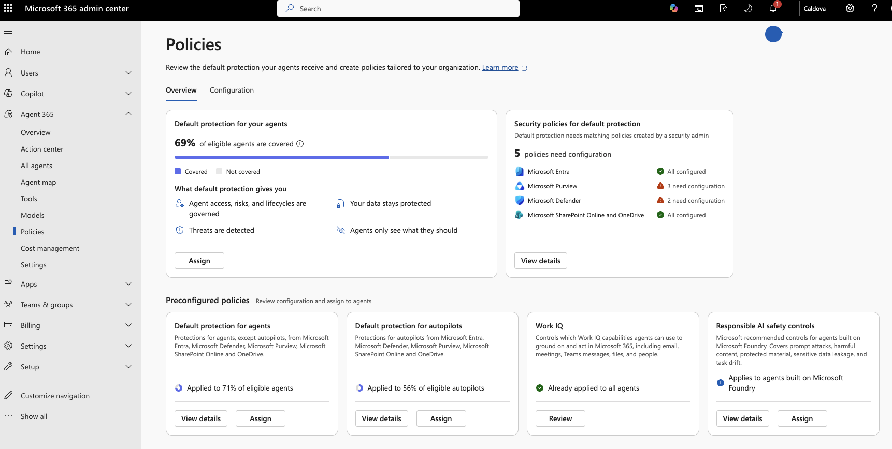

From here, admins have two paths:

| | Path 1: Microsoft-recommended baseline | Path 2: Custom policy |
|---|---|---|
| **Start from** | The preconfigured *Responsible AI safety controls* policy | **Create policy** with the *AI safety* policy type |
| **Controls** | Microsoft defaults, reviewable before assigning | Choose which controls to include, where they apply, and how strictly they block |
| **Best for** | Getting broad coverage fast with a vetted baseline | Matching specific organizational risk tolerance or rollout plans |
| **Effort** | A few clicks | A four-step wizard |

Both paths produce the same kind of policy, scoped to agents built on Microsoft Foundry and registered with Agent 365.

---

## Path 1: Assign the Microsoft-recommended baseline

### 1. Find the preconfigured policy

Under **Preconfigured policies**, the *Responsible AI safety controls* card holds Microsoft-recommended controls for agents built on Microsoft Foundry. It covers prompt attacks, harmful content, protected material, sensitive data leakage, and task adherence.

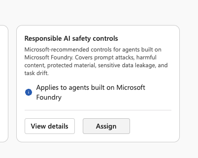

### 2. Review what it does

Select **View details** to see the policy's description, type, status, scope, and how many agents it applies to.

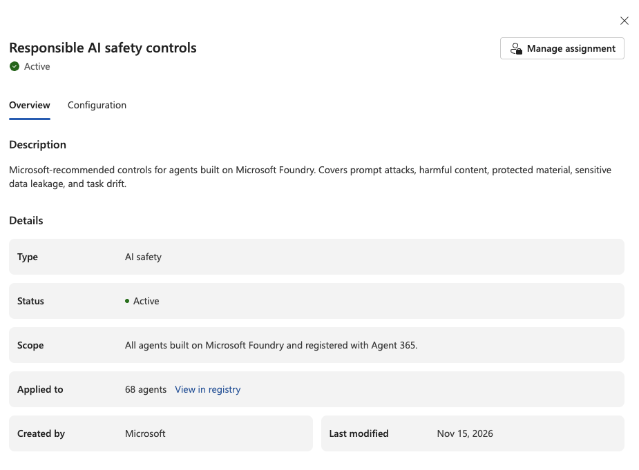

The **Configuration** tab lists each control, where in the agent loop it runs (its intervention points), and its blocking level. Nothing is hidden behind the default.

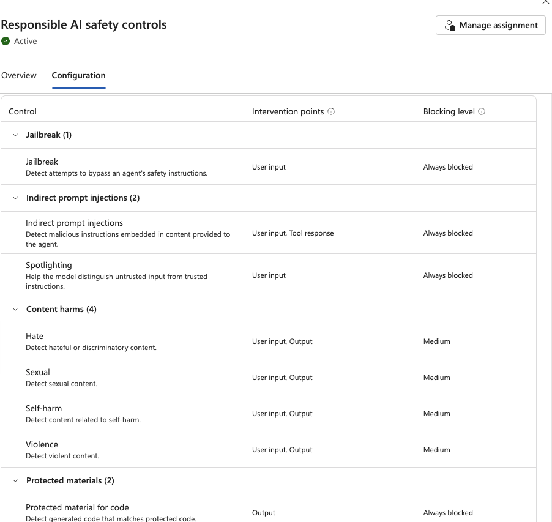

### 3. Assign it

Select **Assign** (or **Manage assignment** from the details pane) and choose which agents the policy covers:

- **Agents registered with Agent 365**, filtered by publisher type and platform. AI safety controls are available for agents built on Microsoft Foundry.
- **Specific agents**, when you want to start with a smaller set.

The panel shows how many agents the assignment reaches before you confirm.

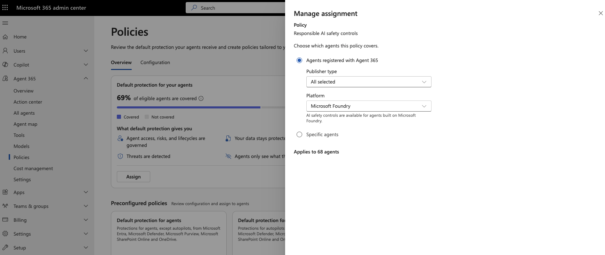

That's it. The baseline is now assigned across your Foundry agents.

---

## Path 2: Create a custom AI safety policy

When the baseline isn't the right fit, admins can build their own. Custom policies live on the **Configuration** tab of the Policies page, next to the other agent policies in the organization: security, tool control, and AI safety.

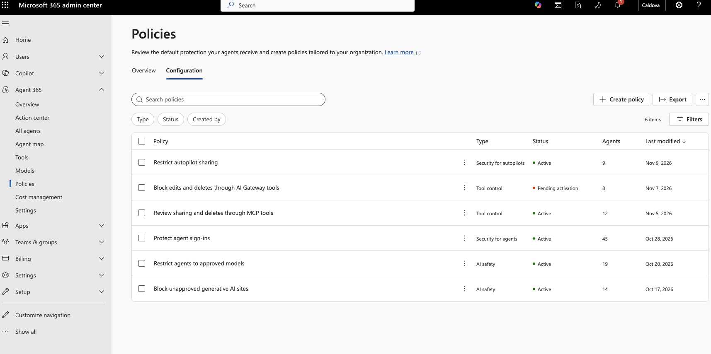

Select **Create policy** to open a four-step wizard.

### Step 1: Basics

Name the policy, add an optional description, and pick the policy type. For responsible AI runtime protection, choose **AI safety**: block harmful content and prompt attacks in agent inputs and outputs, and add data leakage controls.

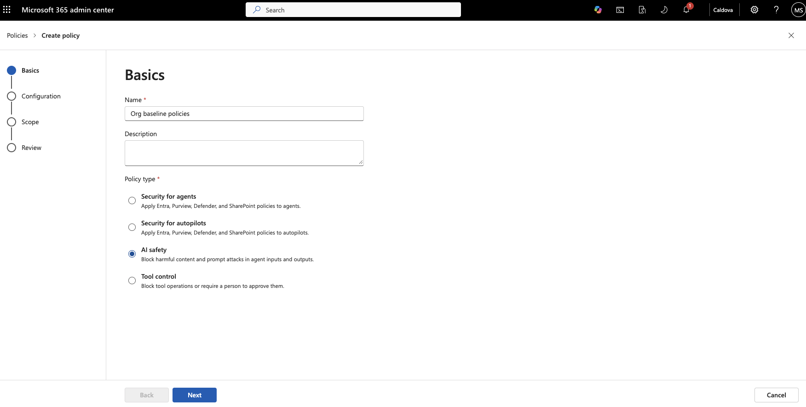

### Step 2: Configuration

Choose which AI safety controls to include. For each control you can set:

- **Intervention points**: where the check runs, such as user input, tool response, tool call, or output.
- **Blocking level**: how strictly detected risks are blocked. Some controls are always blocked; content harm controls let you pick a severity threshold.

**Reset to default** returns every control to the Microsoft-recommended settings, so the baseline is always one click away.

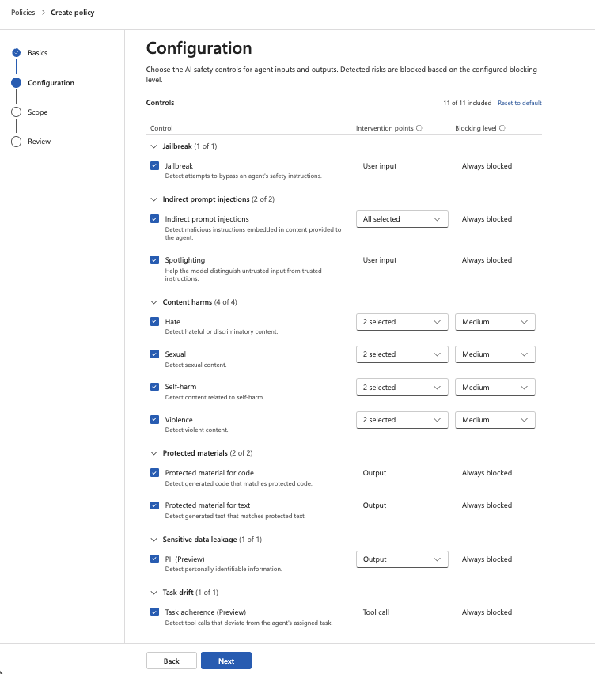

### Step 3: Scope

Choose which agents the policy covers, the same way as in Path 1: all agents registered with Agent 365 (filtered by publisher type and platform), or specific agents.

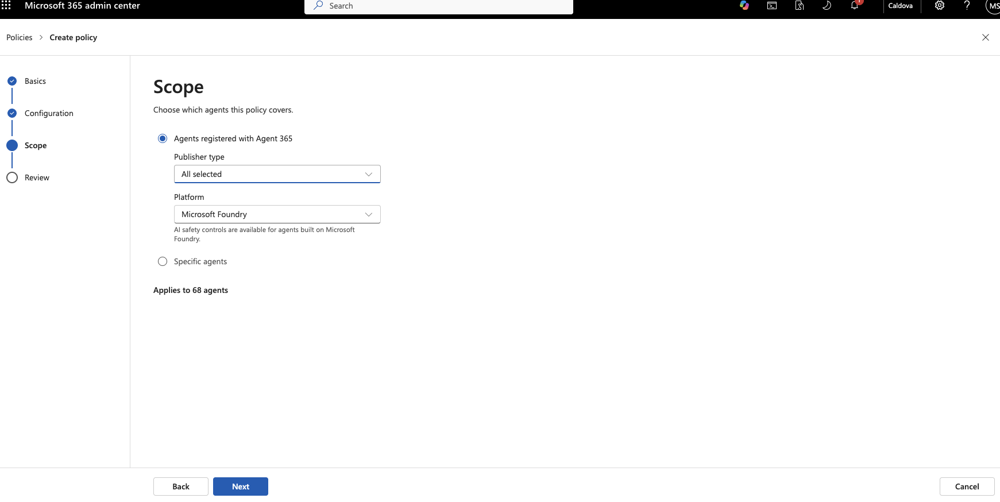

### Step 4: Review

Review the basics and every configured control before creating the policy. Applying an AI safety runtime policy activates the **A365 Content Safety Policy Operator** role, which enables managing responsible AI policy and evaluating it at runtime.

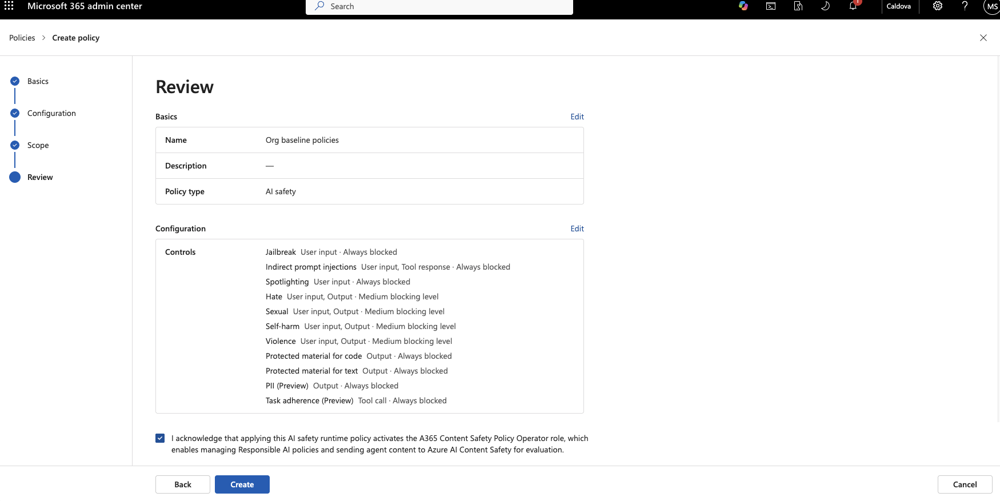

---

## The controls in an AI safety policy

Both paths draw on the same set of 11 controls, grouped by the risk they address. Defaults shown are the Microsoft-recommended settings.

| Category | Control | What it detects | Default intervention points | Default blocking level |
|---|---|---|---|---|
| Jailbreak | Jailbreak | Attempts to bypass an agent's safety instructions | User input | Always blocked |
| Indirect prompt injections | Indirect prompt injections | Malicious instructions embedded in content provided to the agent | User input, tool response | Always blocked |
| Indirect prompt injections | Spotlighting | Helps the model distinguish untrusted input from trusted instructions | User input | Always blocked |
| Content harms | Hate | Hateful or discriminatory content | User input, tool call, tool response, output | Medium |
| Content harms | Sexual | Sexual content | User input, tool call, tool response, output | Medium |
| Content harms | Self-harm | Content related to self-harm | User input, tool call, tool response, output | Medium |
| Content harms | Violence | Violent content | User input, tool call, tool response, output | Medium |
| Protected materials | Protected material for code | Generated code that matches protected code | Output | Always blocked |
| Protected materials | Protected material for text | Generated text that matches protected text | Output | Always blocked |
| Sensitive data leakage | PII (preview) | Personally identifiable information | Input, tool call, tool response, output | Always blocked |
| Task drift | Task adherence (preview) | Tool calls that deviate from the agent's assigned task | Tool call | Always blocked |

---

## Responsible AI policy alongside the protections you already use

Admins already rely on Microsoft Entra for identity, Microsoft Purview for data protection, Microsoft Defender for threat protection, and Microsoft SharePoint Online and OneDrive for content access and sharing. Agent 365 shows default protection coverage from these products in one place, and each protection is enabled and configured in its own admin portal.

Responsible AI policy is authored directly in Agent 365. When an admin applies an AI safety policy, it is compiled into a single ACS policy entity that combines the controls the admin configured with Microsoft's default responsible AI protections.

The result is one artifact per policy, with one identity and one version. At runtime, agent controls evaluates it and returns one decision.

---

## From Agent 365 into Microsoft Foundry

Agent 365 binds the policy through Azure Policy, the same mechanism enterprises already use for Azure governance and compliance. Agent 365 also resolves which subscriptions the policy should reach, so it goes where it needs to go without needing one policy per subscription.

From there, the policy flows down into Microsoft Foundry:

- **Operators** see the inherited organizational policy and its compliance state in the Foundry **Govern** tab.
- **Developers** see its effect on their agents in the **Guardrails** tab. They can add stricter controls on top.

Developers and admins look at the same agent from different sides. A developer knows the agent's tools, users, and workflow, and adds safeguards that fit it, such as stopping a support agent from prompting for a payment card number or showing sensitive data in an answer.

One principle holds throughout: **augment, never weaken.** A developer can tighten policy on their own agent. They can't remove or loosen what the organization requires.

<!-- TODO: link to the Foundry Govern blog -->

---

## Get started

In preview, admins can:

- assign the Microsoft-recommended *Responsible AI safety controls* policy in a few clicks;
- create a custom AI safety policy, choosing controls, intervention points, and blocking levels;
- scope either policy to all Foundry agents registered with Agent 365, or to specific agents;
- rely on agent controls to evaluate it at runtime.

---

## One control foundation, three ways to use it

| Surface | Audience | What it gives you |
|---|---|---|
| **Agent 365** | IT and security admins | Organizational policy across the agent estate. That's this post. |
| [**Microsoft Foundry**](aka.ms/foundry-compliance-blog) | Agent developers | Guardrails and controls inside the build workflow. <!-- TODO: link to the Microsoft Foundry Compliance and Guardrails blog --> |
| [**Agent controls API**](aka.ms/agent-controls-blog) | Platform engineers | Policy decisions from any runtime, framework, or cloud. <!-- TODO: link to the agent controls launch blog --> |

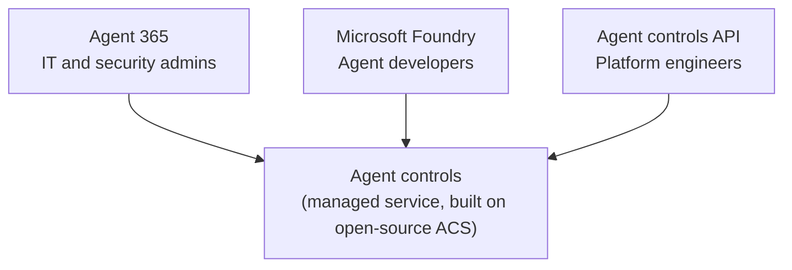

The future of enterprise AI isn't only about how capable agents become. It's about how confidently organizations can delegate work to them. Agent 365 defines what the organization requires, agent developers add their own constraints where their agents need them, and agent controls enforces those decisions at runtime.
